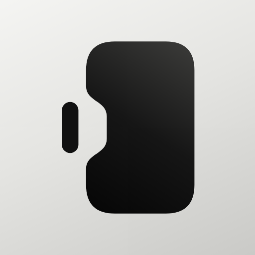
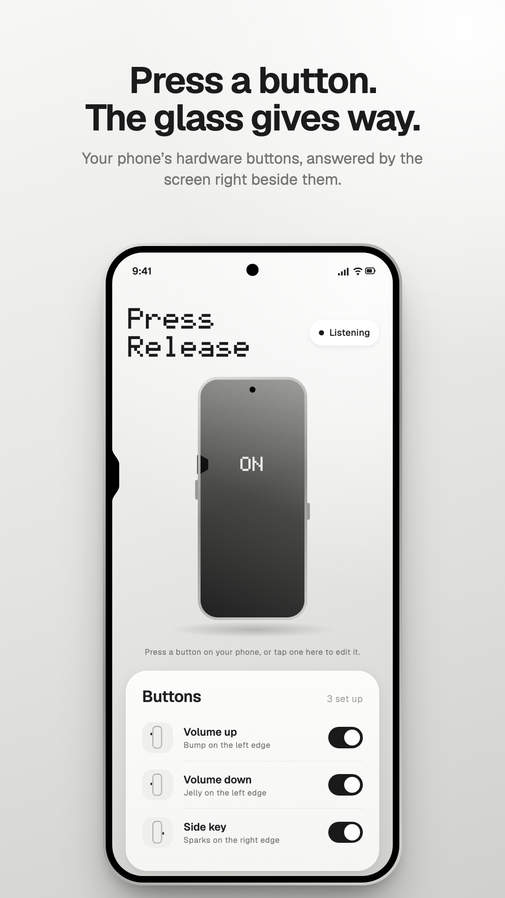
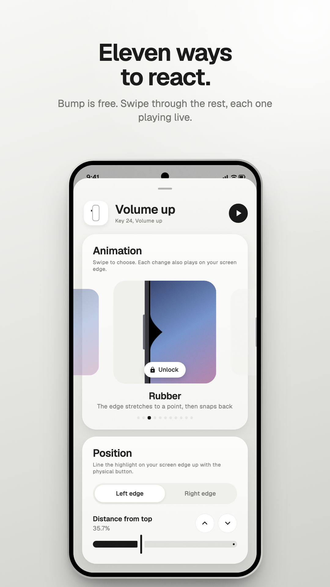
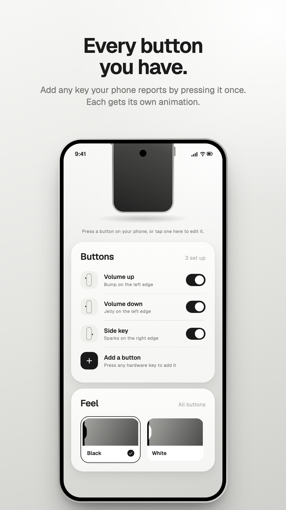
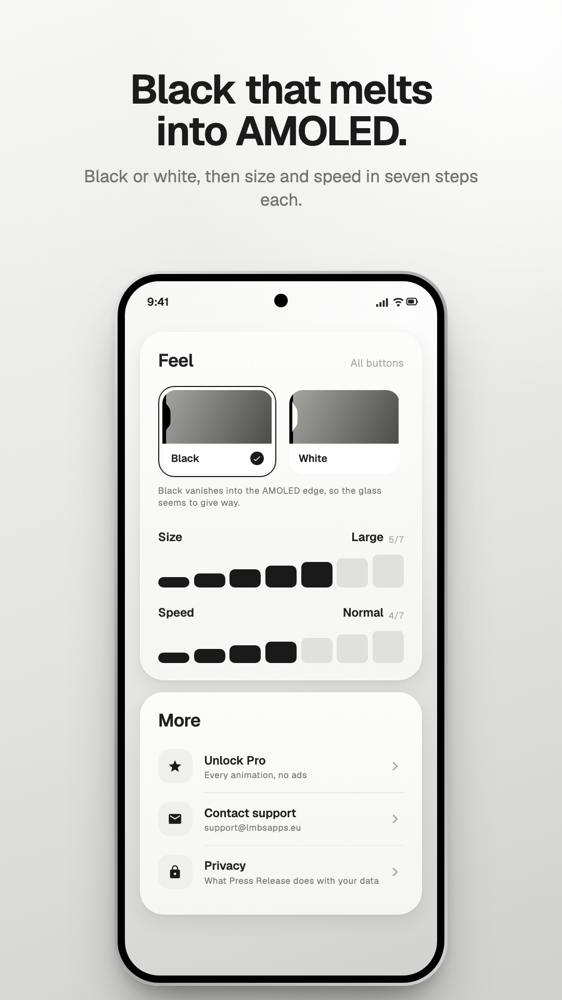
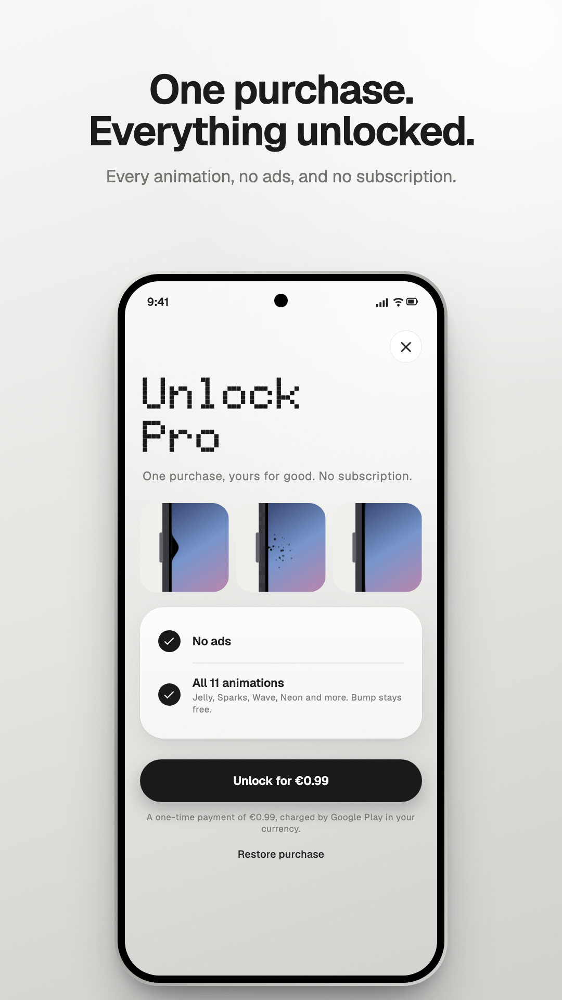

  

<h1 align="center">Press Release</h1>

  An Android app that makes the screen react to the phone's hardware buttons: press one, and the edge of the display right beside it gives way.

  <a href="https://lmbsapps.eu/press-release">Website</a> ·
  <a href="https://github.com/lmbsapps/press-release/issues">Issues</a> ·
  <a href="https://lmbsapps.eu/press-release/privacy">Privacy</a>

  
  
  
  
  

> [!NOTE]
> Press Release is on its way to Google Play. This repository is the public face of the
> project: screenshots, notes on how it works, and the issue tracker. The source is not
> published.

## Why

Recent iPhones answer a press of their side buttons with a small dip in the edge of the
screen, right where your finger is. It is a tiny detail, and it makes the button and the
glass feel like parts of the same object.

Android phones have had physical buttons for as long as they have had screens, and the
screen has never noticed them. Press Release is an attempt at that detail for Android,
and at making it work on any phone, whatever buttons it has and wherever they sit.

## What's in it

**Your buttons.** Volume up and down are set up to begin with. Any other key the phone
reports to Android can be added by pressing it once, including the extra keys some
phones have. Each button has an edge, a position and a length. While you edit one, a
highlight on the real edge of the screen follows the sliders, and arrow buttons nudge it
a quarter of a percent at a time, so it can be lined up with the physical button exactly.

**Eleven animations.** Bump (the dip with a flat floor), Dent, Jelly, Rubber, Pill,
Wave, Glow, Neon, Ripple, Sparks and Beam. Every button can have its own. In the editor
they sit in a row of tiles you swipe through, each one playing.

**Feel.** Black or white, and size and speed in seven steps each. On an AMOLED screen
black pixels are switched off, so in black the dip is indistinguishable from the frame
and the display seems to bend.

**Holding a button.** Effects follow the press: they go in on the press and come back on
the release, so holding the button holds the dip. Sparks keep flying for as long as the
button is held.

## Notes on how it works

**Hearing the buttons.** Hardware key events go to the app in front. The general way
for an app to see them while you use other apps is an accessibility service that asks
to filter key events. Press Release runs one with `flagRequestFilterKeyEvents` and
nothing else. It cannot
retrieve window content (`canRetrieveWindowContent="false"`), and every key event is
returned unconsumed, so volume keys go on working exactly as before. The single
exception is the one press made while adding a new button, which is used to identify the
key and isn't passed on.

**Drawing at the edge.** The effects are drawn in a full-screen, non-touchable
`TYPE_ACCESSIBILITY_OVERLAY` window. Button positions are stored as fractions of the
screen in its natural portrait orientation, and the canvas is rotated to match the
display, so an effect stays next to its physical button when the phone is turned
sideways.

**Motion.** Every effect is a damped spring with its own stiffness, and separate damping
for press and release: Bump goes in critically damped and comes back with a slight
overshoot, Jelly is underdamped both ways. The springs are integrated in 1/240 s steps,
so they behave the same at 60 and 120 Hz. A press is held for at least about 120 ms, so
even a quick tap reaches full depth.

**One renderer.** The overlay, the preview tiles in the editor and the small phone drawn
on the main screen all use the same drawing code, scaled, so a preview is exactly what
will appear on the edge. Nothing draws when no effect is running.

**What can't be done.** The power button turns the screen off before any app sees it, so
it can't have an animation.

**Built with** Kotlin, Jetpack Compose and Material 3, and the
[Doto](https://github.com/oliverlalan/Doto) and [Geist](https://github.com/vercel/geist-font)
typefaces.

## Permissions

| Permission | Used for |
| --- | --- |
| Accessibility service | Noticing presses of the buttons you add, and drawing beside them. Switched on by you in Android's settings, after the app explains what it does |
| Internet, network state | The ad in the free version, and checking the Pro purchase with Google Play |
| Advertising ID | Google's ad software, in the free version |
| Google Play billing | Buying Pro |

Press Release has no account and no server. Button presses are not stored, logged or
sent anywhere, and settings stay on the phone. Details are in the
[privacy policy](https://lmbsapps.eu/press-release/privacy).

## Ads and Pro

The free version has Bump and shows one AdMob banner, at the bottom of the app's own
settings screen. Ads never appear over other apps or at the edge of the screen. Google's
consent form runs before any ad is requested where the law requires it. Pro is a one-time
purchase through Google Play that unlocks the other ten animations and removes the ad.

## Requirements

Android 12 (API 31) or later.

## Feedback

Bugs and ideas go in [Issues](https://github.com/lmbsapps/press-release/issues). For a
bug, the phone, Android version and app version help a lot. *More › Contact support* in
the app fills those in for you if you prefer email
([support@lmbsapps.eu](mailto:support@lmbsapps.eu)).

---

Press Release is not affiliated with Apple or Google. iPhone is a trademark of Apple
Inc.; Android and Google Play are trademarks of Google LLC. Doto and Geist are used
under the SIL Open Font License 1.1. © 2026 lmbsapps. All rights reserved.
